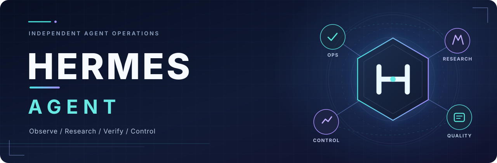
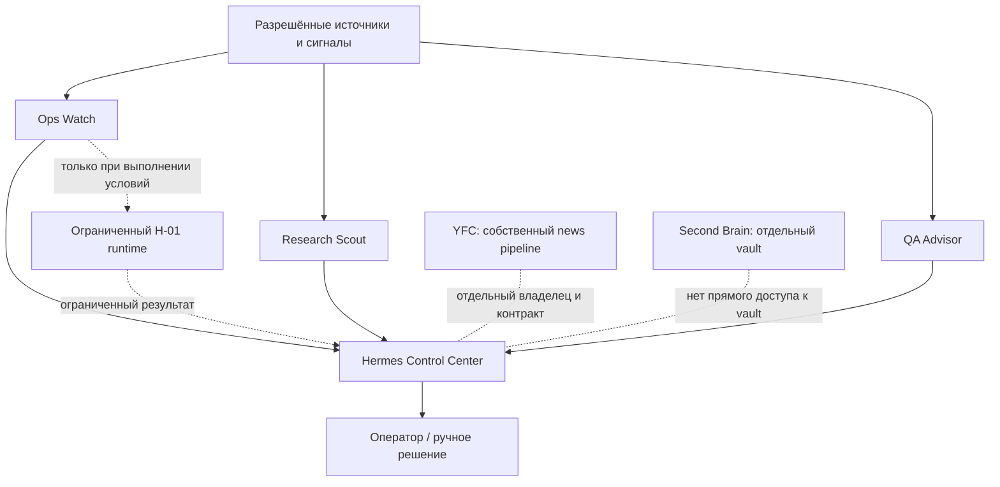

<div align="center">



<br>

**Собственный контур агентных инструментов: наблюдаемость, исследования, контроль качества и управляемые действия.**

Hermes объединяет специализированные возможности вокруг проверяемых данных, явных разрешений и воспроизводимой доставки. Это **не форк** [NousResearch/hermes-agent](https://github.com/NousResearch/hermes-agent) и **не замена** действующим системам YFC или Second Brain.

[**Возможности**](#возможности) · [**Архитектура**](#архитектура-и-границы) · [**Быстрый старт**](#быстрая-проверка) · [**Документация**](#документация) · [**Задачи**](https://github.com/MikeMoore1337/hermes/issues)

[](https://github.com/MikeMoore1337/hermes/actions/workflows/quality.yml)

</div>

---

## Что такое Hermes

**Hermes Agent** - отдельный приватный репозиторий для инфраструктуры и собственных возможностей агентной системы: подсистем наблюдения, исследовательских инструментов, оценки качества, операторской панели, политик и ограниченного исполнения. Исходники upstream-движка не копируются в этот репозиторий.

Идея проста: **собирать сигналы, проверять факты, предлагать действия и выполнять только то, что явно разрешено**. Наличие кода в `main` не означает, что соответствующий сервис запущен или имеет доступ к внешним системам.

## Возможности

| Подсистема | Назначение | Исходники |
| :--- | :--- | :--- |
| **🔭 Ops Watch** | Сигналы инфраструктуры, инциденты, безопасные уведомления и проверка восстановления | [`ops_watch/`](ops_watch/) |
| **🔬 Research Scout** | Поиск научных публикаций, проверка метаданных, происхождения и достоверности источников; выводы проходят ручную экспертизу | [`research_scout/`](research_scout/) |
| **🧪 QA Advisor** | Анализ GitHub Actions и CI-сигналов, проверяемые свидетельства без права изменять чужие репозитории | [`qa_advisor/`](qa_advisor/) |
| **🖥️ Control Center** | Операторский интерфейс для наблюдения за компонентами, квотами, состоянием и доступными действиями | [`control_center/`](control_center/) |
| **⚡ H-01 runtime** | Ограниченный агентный контур с отдельными правилами доступа и лимитами; эксплуатационная приёмка ведётся отдельно | [`deploy/`](deploy/) · [#33](https://github.com/MikeMoore1337/hermes/issues/33) |
| **🛡️ Evaluation & Policy** | Offline-проверки ограничений, регрессий и нежелательных действий, тестовые сценарии и эталонные оценки | [`evals/`](evals/) · [`hermes_benchmark/`](hermes_benchmark/) · [`policies/`](policies/) |

> **Актуальность:** это карта компонентов в исходном коде, а не таблица работающих на VPS служб. Состояние конкретного развёртывания устанавливается по [операционным проверкам](docs/operations/DEPLOYMENT.md), [фактическому статусу от 15.10.2026](docs/status/HERMES-CURRENT-2026-10-15.md) и незакрытым условиям [H-01 #33](https://github.com/MikeMoore1337/hermes/issues/33).

## Архитектура и границы



- **Изоляция:** инструменты, доступ к сети, данным и ресурсам ограничиваются отдельно; описание роли само по себе не является защитой.
- **Разделение ответственности:** рабочий новостной конвейер принадлежит [Your Fitness Coach](https://github.com/MikeMoore1337/your-fitness-coach); данные и vault принадлежат [Second Brain](https://github.com/MikeMoore1337/second-brain).
- **Никаких скрытых полномочий:** внешние публикации, новые поставщики, расходы и расширение доступа требуют предусмотренных проектом решений.
- **Не путать стадии:** реализация, offline-тесты, CI, merge, production snapshot и реальная активация сервиса подтверждаются независимо.

Подробности: [архитектурный обзор](docs/architecture/OVERVIEW.md) · [контракты владения](docs/architecture/OWNERSHIP.md) · [модель угроз](docs/security/THREAT_MODEL.md).

## Быстрая проверка

Для локальной проверки репозитория нужен **Python 3**. Базовые проверки и unit-тесты запускаются из корня, без ключей доступа и платных AI API:

```bash
python3 scripts/validate_repo.py
python3 scripts/check_policy_index.py
python3 scripts/check_markdown_links.py
python3 -m unittest discover -s tests -v
```

Основной CI запускает эти проверки, а также отдельные offline-сценарии оценки поведения. **Эти команды ничего не развёртывают**. Установка и выпуск описаны отдельно в [документации по доставке](docs/operations/DEPLOYMENT.md).

## Документация

| Начать с | Где читать |
| :--- | :--- |
| **Текущий операционный контекст** | [Эксплуатация и точная доставка](docs/operations/DEPLOYMENT.md) · [зафиксированное состояние](docs/status/HERMES-CURRENT-2026-10-15.md) |
| **Правила работы в репозитории** | [AGENTS.md](AGENTS.md) · [принятые решения](docs/decisions/ADR-0002-workers-free-and-delivery-first.md) |
| **Система и границы** | [Архитектура](docs/architecture/OVERVIEW.md) · [Ownership](docs/architecture/OWNERSHIP.md) · [Security](docs/security/THREAT_MODEL.md) |
| **Разработка и поставка** | [Deployment](docs/operations/DEPLOYMENT.md) · [Дорожная карта](docs/roadmap/ROADMAP.md) |
| **Испытания и качество** | [Offline-evals](evals/) · [Бенчмарк](hermes_benchmark/) · [GitHub Actions](.github/workflows/quality.yml) |

## Как устроена работа

**Issue → отдельная ветка → PR → проверки → разрешённое объединение → подтверждённая доставка.**

Изменения проходят проверки именно той ревизии, которую предполагается поставлять. Автоматическая доставка и работающий сервис - разные факты; для новых возможностей сохраняются необходимые ограничения и разрешения. См. [правила для агентов](AGENTS.md) и [политику эксплуатации](docs/operations/DEPLOYMENT.md).

---

<div align="center">

<sub>Hermes Agent · Private, owner-operated project · Powered by verifiable evidence, not assumptions.</sub>

</div>
